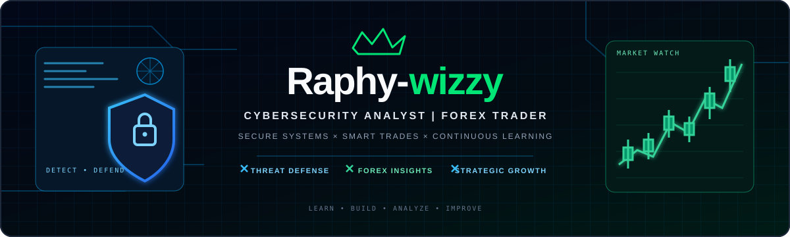

  

<h1 align="center">Hey there, I'm Raphy-wizzy 👋</h1>

  <strong>Cybersecurity Analyst 🛡️ | Forex Trader 📈</strong> 
  Interested in securing systems, understanding markets, and continuously sharpening my skills.

  
  
  

🧭 About Me
- 🔐 Focused on cybersecurity, threat awareness, and protecting digital systems.
- 📊 Interested in forex markets, price action, and disciplined trade planning.
- 🧠 Always learning, practicing, and documenting what I discover.
- 🤝 Open to connecting with people in cybersecurity, technology, and trading.
🛡️ Cybersecurity Interests
- Security monitoring and threat analysis
- Networking and system fundamentals
- Vulnerability awareness and defensive security
- Scripting, automation, and security labs
📈 Forex Trading Approach
- Market structure and price action
- Risk management and trade journaling
- Patience, consistency, and continuous review
Trading involves risk. I value a process-led approach and never treat returns as guaranteed.

🧰 Tools & Technologies
<!-- Update these badges to reflect tools you actively use. -->

  
  
  
  
  

🎯 Current Mission
Secure systems. Study markets. Build useful skills. Repeat.

  <em>“Discipline in security. Patience in trading. Consistency in growth.”</em>

  Raphy-wizzy • Cybersecurity × Forex • Learn · Build · Improve

